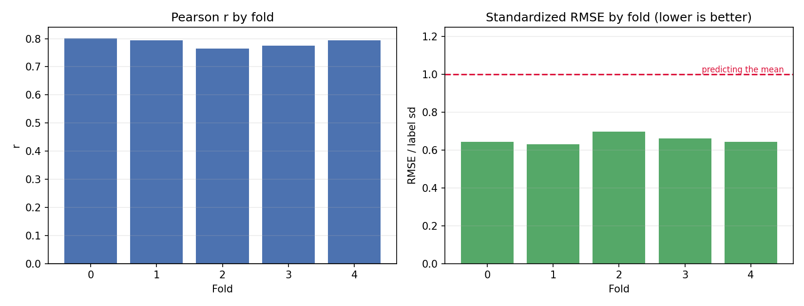
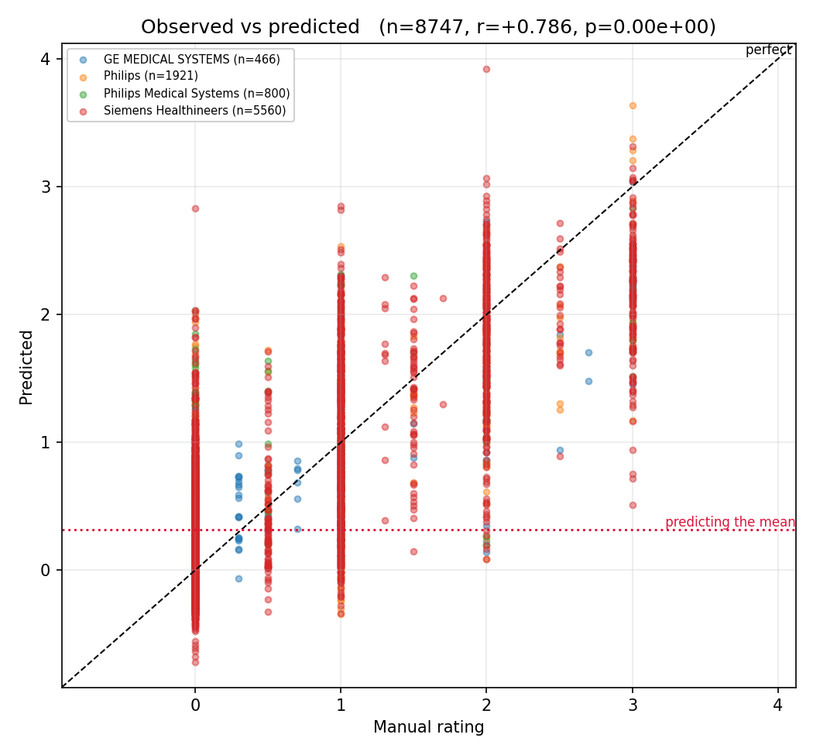
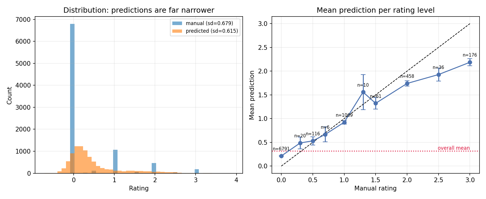
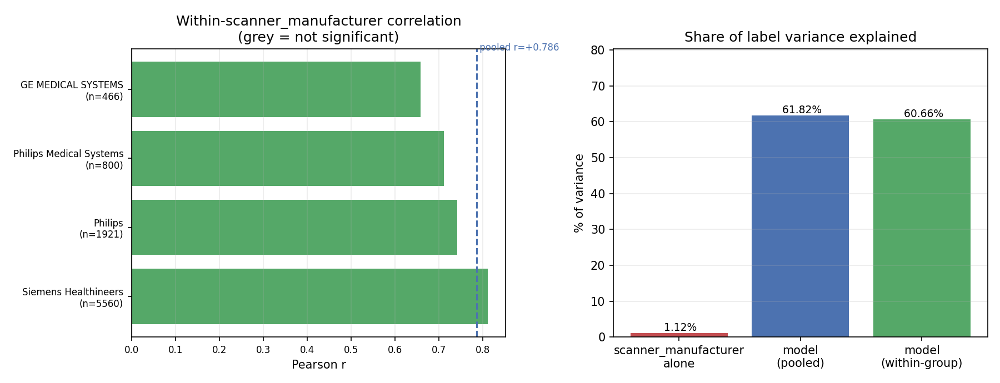

# model_04l0_pf2 per-frame QU_line

_Generated 2026-11-17 15:21_

## Summary

- **8747 predictions** across 5 folds, 1243 subjects
- **Pooled r = +0.786** (p = 0.00e+00), Spearman = +0.589
- **r² = 61.82%** of label variance explained
- **standardized RMSE = 0.655**
  - a mean-predictor scores exactly 1.0; this is below 1.0, so the model beats the mean baseline by 34.5%
- prediction sd 0.615 vs label sd 0.679 — predictions span 91% of the label spread

## Per-fold

|   fold |    n |      r |      p |   spearman |   rmse |   label_sd |   std_rmse |
|-------:|-----:|-------:|-------:|-----------:|-------:|-----------:|-----------:|
|      0 | 1797 | 0.8007 | 0.0000 |     0.6045 | 0.4427 |     0.6883 |     0.6432 |
|      1 | 1737 | 0.7949 | 0.0000 |     0.5821 | 0.4327 |     0.6867 |     0.6301 |
|      2 | 1633 | 0.7648 | 0.0000 |     0.5768 | 0.4747 |     0.6794 |     0.6987 |
|      3 | 1702 | 0.7758 | 0.0000 |     0.5886 | 0.4335 |     0.6563 |     0.6605 |
|      4 | 1878 | 0.7948 | 0.0000 |     0.5899 | 0.4404 |     0.6831 |     0.6448 |

## Confound check: scanner_manufacturer

If a grouping variable shifts the label mean, a model that learns only the group offset earns a pooled correlation while carrying no within-group signal.

| group                   |    n |   label mean |   pred mean |   within r |   within p |
|:------------------------|-----:|-------------:|------------:|-----------:|-----------:|
| Siemens Healthineers    | 5560 |       0.3370 |      0.4469 |     0.8117 |     0.0000 |
| Philips                 | 1921 |       0.2332 |      0.3656 |     0.7414 |     0.0000 |
| Philips Medical Systems |  800 |       0.2550 |      0.4081 |     0.7111 |     0.0000 |
| GE MEDICAL SYSTEMS      |  466 |       0.5549 |      0.7453 |     0.6584 |     0.0000 |

- scanner_manufacturer alone explains **1.12%** of label variance (a group-mean lookup would score r = +0.106)
- model pooled r = +0.786 (r² = 61.82%)
- sample-weighted **within-group r = +0.779** (r² = 60.66%)
- **~1% of the pooled correlation is between-group**, not within

## Figures

### Per-fold correlation and standardized RMSE

### Observed vs predicted

### Prediction spread and calibration

### Within-scanner_manufacturer signal vs confound

