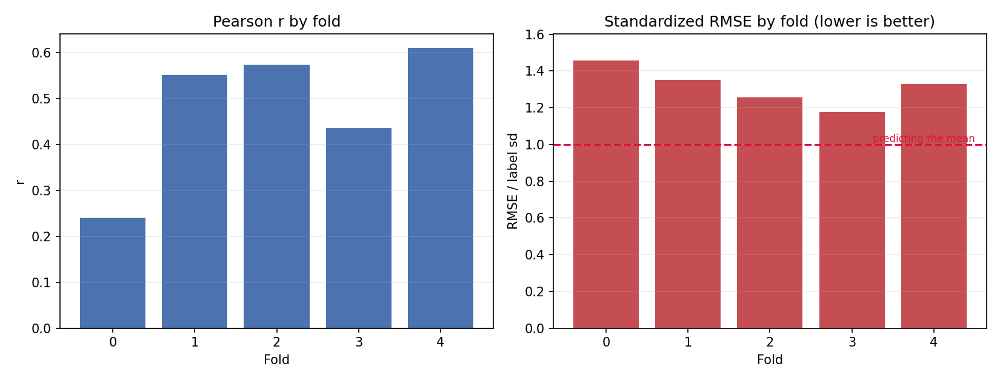
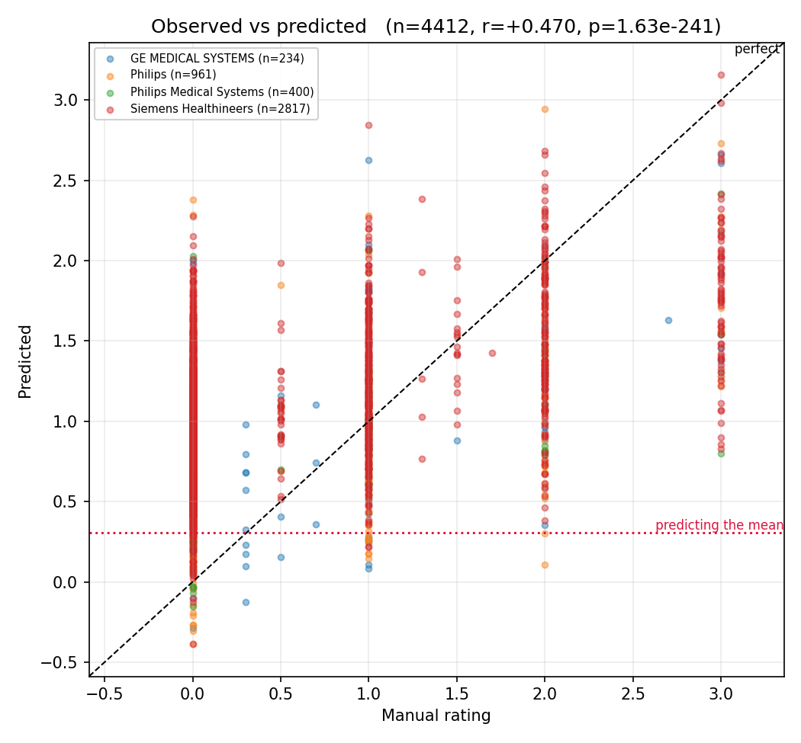
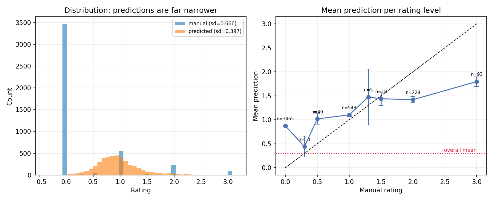
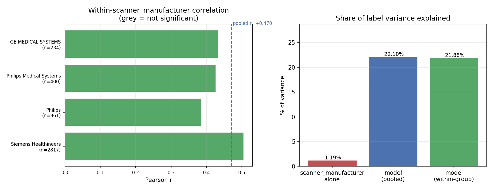
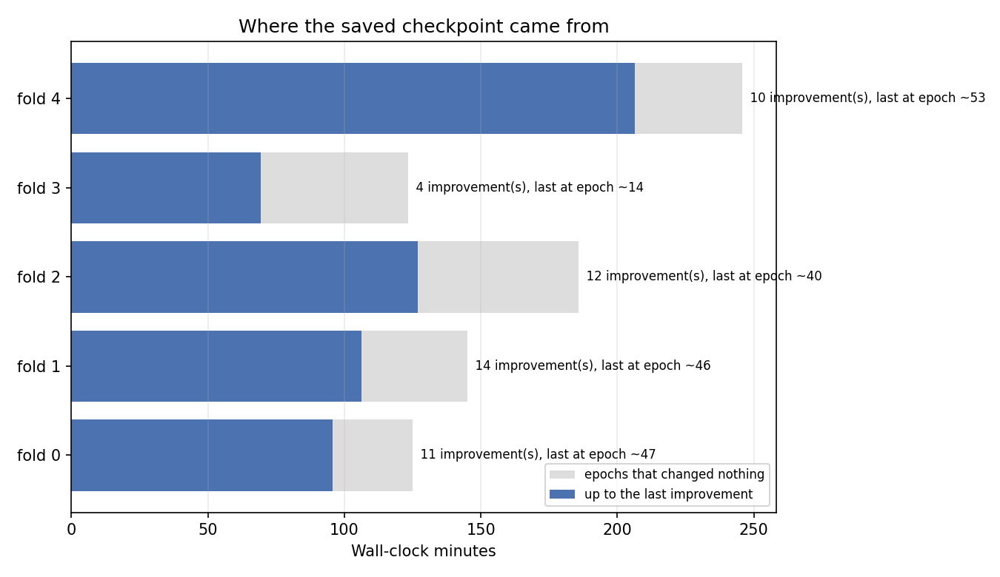

# QU_line split-frames (model_04l0_split)

_Generated 2026-10-20 10:17_

## Summary

- **4412 predictions** across 5 folds, 1243 subjects
- **Pooled r = +0.470** (p = 1.63e-241), Spearman = +0.350
- **r² = 22.10%** of label variance explained
- **standardized RMSE = 1.319**
  - a mean-predictor scores exactly 1.0; this is at or above 1.0, so the model does **not** beat simply predicting the label mean
- prediction sd 0.397 vs label sd 0.666 — predictions span 60% of the label spread

## Per-fold

|   fold |   n |      r |      p |   spearman |   rmse |   label_sd |   std_rmse |
|-------:|----:|-------:|-------:|-----------:|-------:|-----------:|-----------:|
|      0 | 892 | 0.2410 | 0.0000 |     0.1852 | 0.9849 |     0.6763 |     1.4562 |
|      1 | 838 | 0.5517 | 0.0000 |     0.4374 | 0.8996 |     0.6663 |     1.3501 |
|      2 | 867 | 0.5738 | 0.0000 |     0.3817 | 0.8411 |     0.6705 |     1.2545 |
|      3 | 904 | 0.4362 | 0.0000 |     0.2702 | 0.7611 |     0.6462 |     1.1777 |
|      4 | 911 | 0.6107 | 0.0000 |     0.4843 | 0.8943 |     0.6727 |     1.3293 |

## Confound check: scanner_manufacturer

If a grouping variable shifts the label mean, a model that learns only the group offset earns a pooled correlation while carrying no within-group signal.

| group                   |    n |   label mean |   pred mean |   within r |   within p |
|:------------------------|-----:|-------------:|------------:|-----------:|-----------:|
| Siemens Healthineers    | 2817 |       0.3215 |      1.0279 |     0.5045 |     0.0000 |
| Philips                 |  961 |       0.2222 |      0.7816 |     0.3857 |     0.0000 |
| Philips Medical Systems |  400 |       0.2437 |      0.8509 |     0.4259 |     0.0000 |
| GE MEDICAL SYSTEMS      |  234 |       0.5526 |      0.9331 |     0.4328 |     0.0000 |

- scanner_manufacturer alone explains **1.19%** of label variance (a group-mean lookup would score r = +0.109)
- model pooled r = +0.470 (r² = 22.10%)
- sample-weighted **within-group r = +0.468** (r² = 21.88%)
- **~1% of the pooled correlation is between-group**, not within

## Convergence

|   fold |   train |   val |   epochs |   improvements |   last impr. epoch |   min to last impr. |   wall min |   best val loss |
|-------:|--------:|------:|---------:|---------------:|-------------------:|--------------------:|-----------:|----------------:|
|      0 |    6975 |  1772 |      100 |             11 |                 47 |               95.78 |     124.93 |            0.00 |
|      1 |    7089 |  1658 |      100 |             14 |                 46 |              106.30 |     145.02 |            0.00 |
|      2 |    7040 |  1707 |      100 |             12 |                 40 |              126.80 |     185.90 |            0.00 |
|      3 |    6950 |  1797 |      100 |              4 |                 14 |               69.50 |     123.33 |            0.00 |
|      4 |    6934 |  1813 |      100 |             10 |                 53 |              206.53 |     245.80 |            0.00 |

- total wall time 13.7 h; **3.7 h produced no improvement**
- mean best validation loss 0.0016 vs label variance 0.4439 (-99.6% vs the mean predictor)
- if improvement stops early, more epochs will not help; add early stopping to make iteration cheap

## Figures

### Per-fold correlation and standardized RMSE

### Observed vs predicted

### Prediction spread and calibration

### Within-scanner_manufacturer signal vs confound

### Where the saved checkpoint came from

