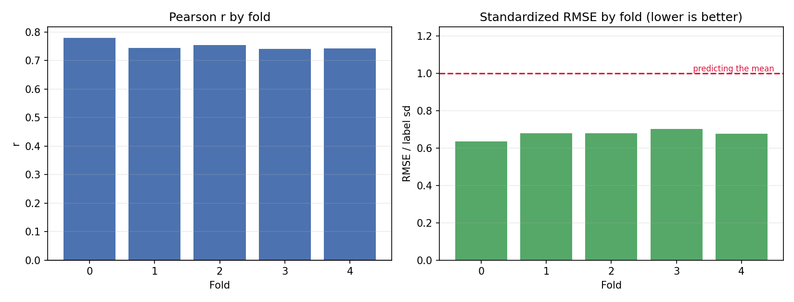
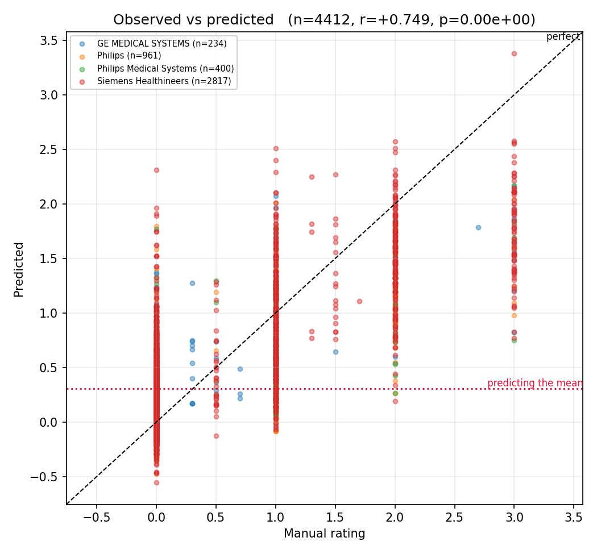
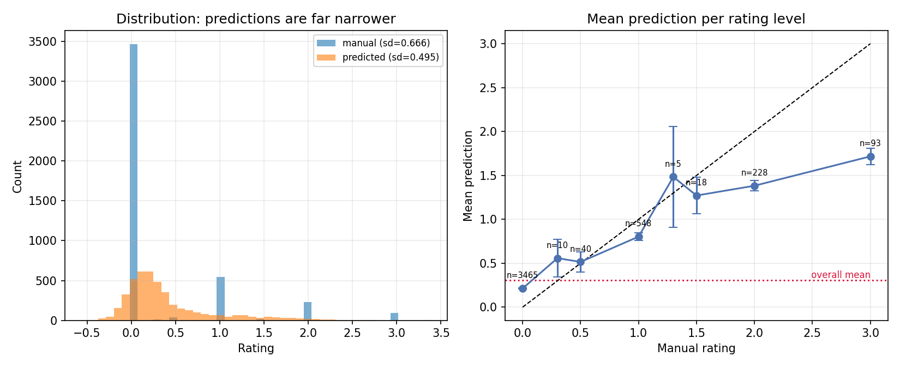
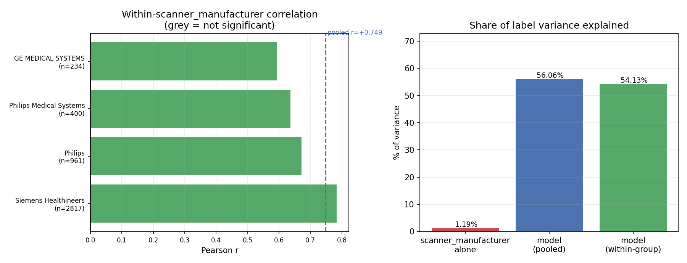
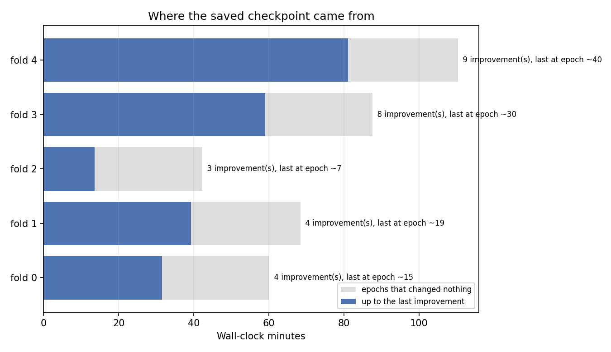

# QU_line split-frames, weight-power 0.5 (model_04l0_w05)

_Generated 2026-10-21 16:35_

## Summary

- **4412 predictions** across 5 folds, 1243 subjects
- **Pooled r = +0.749** (p = 0.00e+00), Spearman = +0.581
- **r² = 56.06%** of label variance explained
- **standardized RMSE = 0.675**
  - a mean-predictor scores exactly 1.0; this is below 1.0, so the model beats the mean baseline by 32.5%
- prediction sd 0.495 vs label sd 0.666 — predictions span 74% of the label spread

## Per-fold

|   fold |   n |      r |      p |   spearman |   rmse |   label_sd |   std_rmse |
|-------:|----:|-------:|-------:|-----------:|-------:|-----------:|-----------:|
|      0 | 892 | 0.7791 | 0.0000 |     0.6070 | 0.4295 |     0.6763 |     0.6350 |
|      1 | 838 | 0.7449 | 0.0000 |     0.5971 | 0.4531 |     0.6663 |     0.6800 |
|      2 | 867 | 0.7541 | 0.0000 |     0.5742 | 0.4555 |     0.6705 |     0.6795 |
|      3 | 904 | 0.7409 | 0.0000 |     0.5509 | 0.4534 |     0.6462 |     0.7017 |
|      4 | 911 | 0.7422 | 0.0000 |     0.5852 | 0.4552 |     0.6727 |     0.6767 |

## Confound check: scanner_manufacturer

If a grouping variable shifts the label mean, a model that learns only the group offset earns a pooled correlation while carrying no within-group signal.

| group                   |    n |   label mean |   pred mean |   within r |   within p |
|:------------------------|-----:|-------------:|------------:|-----------:|-----------:|
| Siemens Healthineers    | 2817 |       0.3215 |      0.4071 |     0.7833 |     0.0000 |
| Philips                 |  961 |       0.2222 |      0.2938 |     0.6722 |     0.0000 |
| Philips Medical Systems |  400 |       0.2437 |      0.3293 |     0.6361 |     0.0000 |
| GE MEDICAL SYSTEMS      |  234 |       0.5526 |      0.6572 |     0.5943 |     0.0000 |

- scanner_manufacturer alone explains **1.19%** of label variance (a group-mean lookup would score r = +0.109)
- model pooled r = +0.749 (r² = 56.06%)
- sample-weighted **within-group r = +0.736** (r² = 54.13%)
- **~2% of the pooled correlation is between-group**, not within

## Convergence

|   fold |   train |   val |   epochs run |   max epochs |   improvements |   last impr. epoch |   min to last impr. |   wall min |   best val loss |
|-------:|--------:|------:|-------------:|-------------:|---------------:|-------------------:|--------------------:|-----------:|----------------:|
|      0 |    6975 |  1772 |           30 |          100 |              4 |                 15 |               31.57 |      60.12 |          0.3642 |
|      1 |    7089 |  1658 |           33 |          100 |              4 |                 19 |               39.22 |      68.45 |          0.4462 |
|      2 |    7040 |  1707 |           21 |          100 |              3 |                  7 |               13.57 |      42.28 |          0.3892 |
|      3 |    6950 |  1797 |           44 |          100 |              8 |                 30 |               58.98 |      87.57 |          0.454  |
|      4 |    6934 |  1813 |           54 |          100 |              9 |                 40 |               81.1  |     110.3  |          0.4397 |

- total wall time 6.1 h; **2.4 h produced no improvement**
- every fold stopped early (epochs 30, 33, 21, 44, 54 of 100), so patience is doing its job
- mean best validation loss 0.4187
  - NOTE: with `--use-weighted-loss` this is a *weighted* loss and is not on the same scale as label variance (0.4439); comparing the two says nothing about accuracy. Use standardized_rmse above for that, or pass `--weight-normalize` at training time to put the loss back on the MSE scale.
## Figures

### Per-fold correlation and standardized RMSE

### Observed vs predicted

### Prediction spread and calibration

### Within-scanner_manufacturer signal vs confound

### Where the saved checkpoint came from

