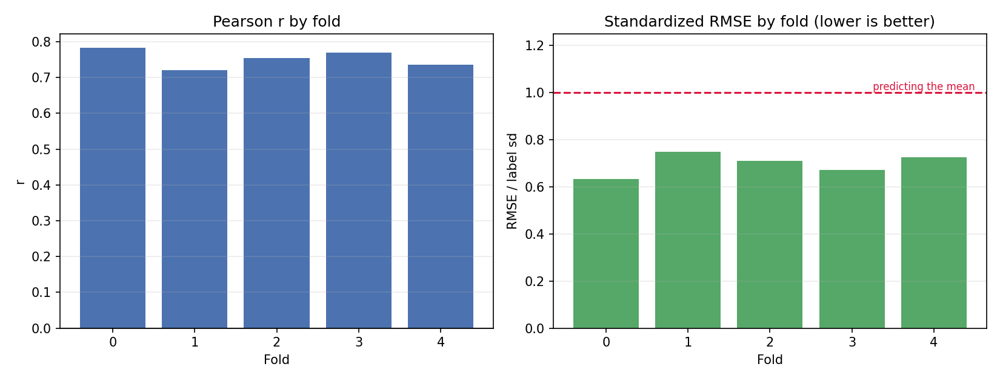
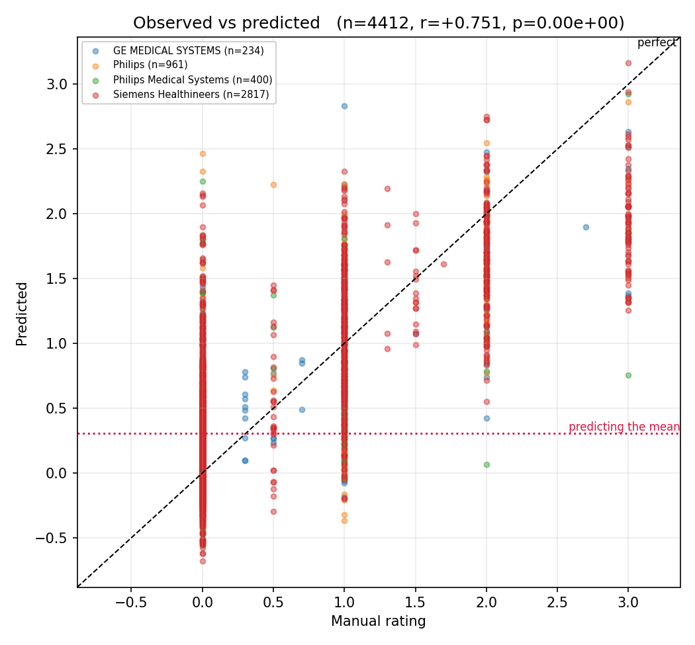
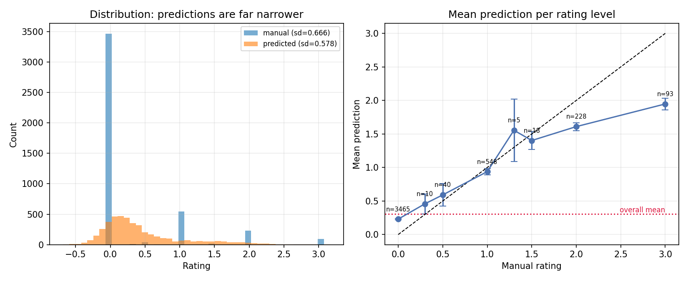
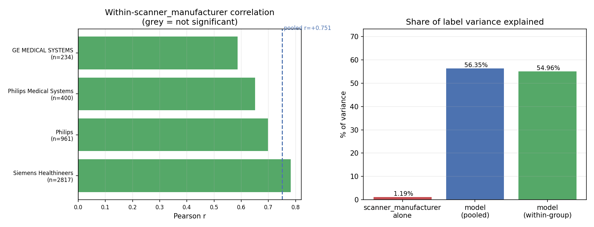
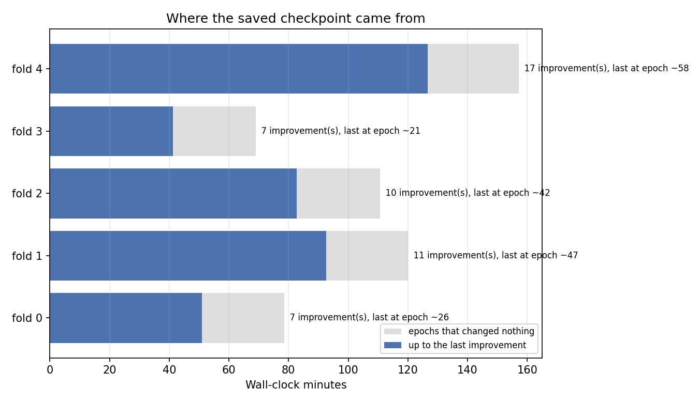

# QU_line split-frames, weight-power 0.5, augmented (model_04l0_w05aug)

_Generated 2026-10-22 15:02_

## Summary

- **4412 predictions** across 5 folds, 1243 subjects
- **Pooled r = +0.751** (p = 0.00e+00), Spearman = +0.592
- **r² = 56.35%** of label variance explained
- **standardized RMSE = 0.699**
  - a mean-predictor scores exactly 1.0; this is below 1.0, so the model beats the mean baseline by 30.1%
- prediction sd 0.578 vs label sd 0.666 — predictions span 87% of the label spread

## Per-fold

|   fold |   n |      r |      p |   spearman |   rmse |   label_sd |   std_rmse |
|-------:|----:|-------:|-------:|-----------:|-------:|-----------:|-----------:|
|      0 | 892 | 0.7826 | 0.0000 |     0.6090 | 0.4287 |     0.6763 |     0.6338 |
|      1 | 838 | 0.7197 | 0.0000 |     0.5976 | 0.4989 |     0.6663 |     0.7487 |
|      2 | 867 | 0.7541 | 0.0000 |     0.5601 | 0.4767 |     0.6705 |     0.7110 |
|      3 | 904 | 0.7698 | 0.0000 |     0.5777 | 0.4349 |     0.6462 |     0.6730 |
|      4 | 911 | 0.7354 | 0.0000 |     0.6094 | 0.4880 |     0.6727 |     0.7254 |

## Confound check: scanner_manufacturer

If a grouping variable shifts the label mean, a model that learns only the group offset earns a pooled correlation while carrying no within-group signal.

| group                   |    n |   label mean |   pred mean |   within r |   within p |
|:------------------------|-----:|-------------:|------------:|-----------:|-----------:|
| Siemens Healthineers    | 2817 |       0.3215 |      0.4483 |     0.7819 |     0.0000 |
| Philips                 |  961 |       0.2222 |      0.3500 |     0.6979 |     0.0000 |
| Philips Medical Systems |  400 |       0.2437 |      0.3936 |     0.6507 |     0.0000 |
| GE MEDICAL SYSTEMS      |  234 |       0.5526 |      0.7279 |     0.5864 |     0.0000 |

- scanner_manufacturer alone explains **1.19%** of label variance (a group-mean lookup would score r = +0.109)
- model pooled r = +0.751 (r² = 56.35%)
- sample-weighted **within-group r = +0.741** (r² = 54.96%)
- **~1% of the pooled correlation is between-group**, not within

## Convergence

|   fold |   train |   val |   epochs run |   max epochs |   improvements |   last impr. epoch |   min to last impr. |   wall min |   best val loss |
|-------:|--------:|------:|-------------:|-------------:|---------------:|-------------------:|--------------------:|-----------:|----------------:|
|      0 |    6975 |  1772 |           40 |          100 |              7 |                 26 |               50.88 |      78.48 |          0.3439 |
|      1 |    7089 |  1658 |           61 |          100 |             11 |                 47 |               92.68 |     120    |          0.4026 |
|      2 |    7040 |  1707 |           56 |          100 |             10 |                 42 |               82.77 |     110.7  |          0.3157 |
|      3 |    6950 |  1797 |           35 |          100 |              7 |                 21 |               41.23 |      69.08 |          0.3518 |
|      4 |    6934 |  1813 |           72 |          100 |             17 |                 58 |              126.6  |     157.2  |          0.3137 |

- total wall time 8.9 h; **2.4 h produced no improvement**
- every fold stopped early (epochs 40, 61, 56, 35, 72 of 100), so patience is doing its job
- mean best validation loss 0.3456
  - NOTE: with `--use-weighted-loss` this is a *weighted* loss and is not on the same scale as label variance (0.4439); comparing the two says nothing about accuracy. Use standardized_rmse above for that, or pass `--weight-normalize` at training time to put the loss back on the MSE scale.
## Figures

### Per-fold correlation and standardized RMSE

### Observed vs predicted

### Prediction spread and calibration

### Within-scanner_manufacturer signal vs confound

### Where the saved checkpoint came from

