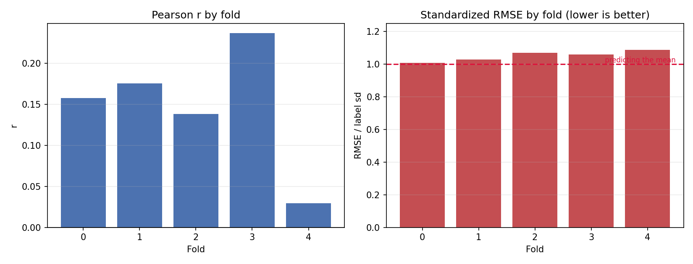
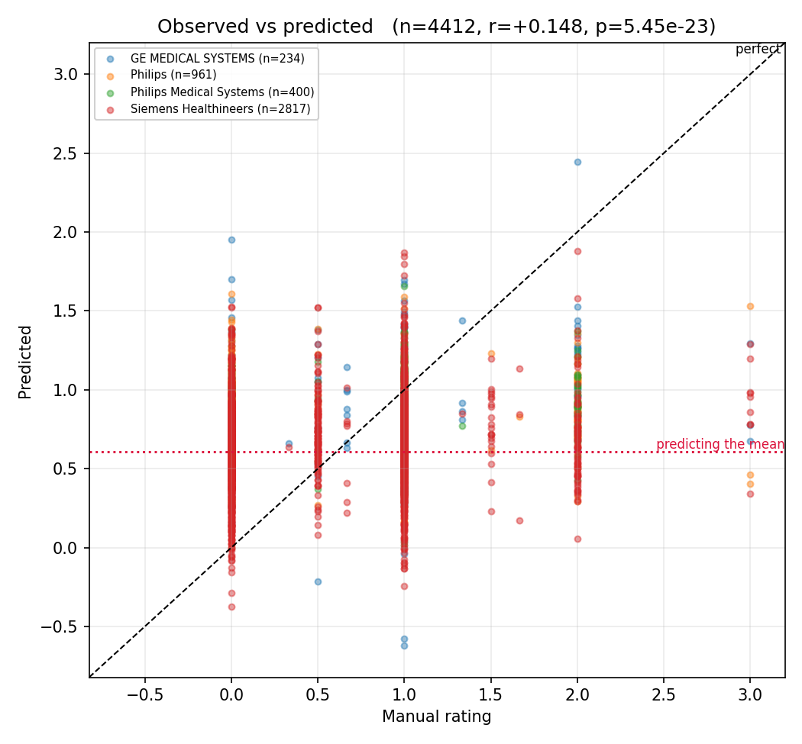
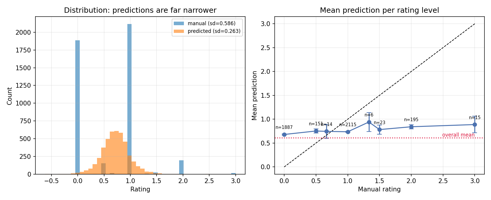
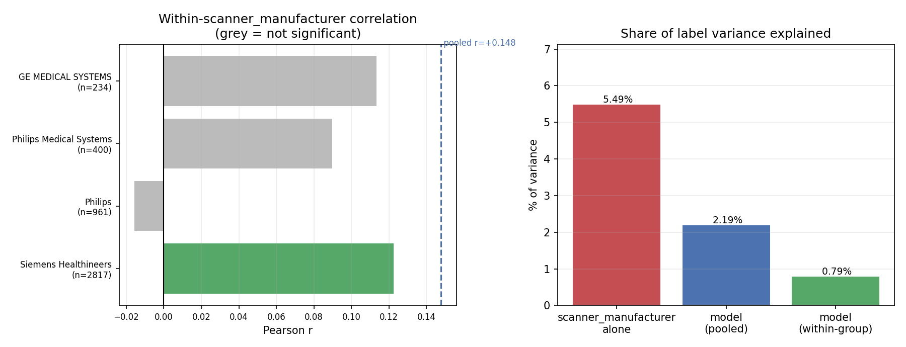
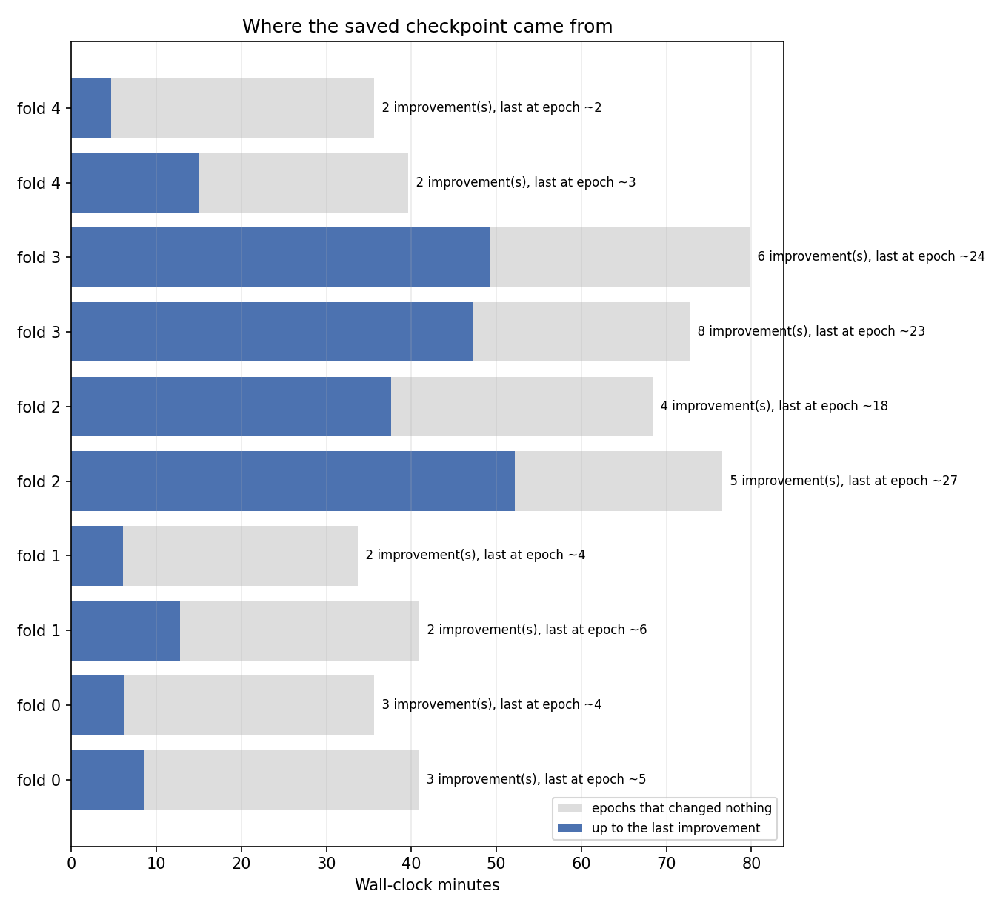

# QU_sus split-frames, weight-power 0.5 (model_04s0_w05)

_Generated 2026-10-23 11:34_

## Summary

- **4412 predictions** across 5 folds, 1243 subjects
- **Pooled r = +0.148** (p = 5.45e-23), Spearman = +0.144
- **r² = 2.19%** of label variance explained
- **standardized RMSE = 1.051**
  - a mean-predictor scores exactly 1.0; this is at or above 1.0, so the model does **not** beat simply predicting the label mean
- prediction sd 0.263 vs label sd 0.586 — predictions span 45% of the label spread

## Per-fold

|   fold |   n |      r |      p |   spearman |   rmse |   label_sd |   std_rmse |
|-------:|----:|-------:|-------:|-----------:|-------:|-----------:|-----------:|
|      0 | 885 | 0.1575 | 0.0000 |     0.1660 | 0.5915 |     0.5869 |     1.0079 |
|      1 | 880 | 0.1757 | 0.0000 |     0.1763 | 0.6257 |     0.6086 |     1.0279 |
|      2 | 902 | 0.1380 | 0.0000 |     0.1265 | 0.6257 |     0.5851 |     1.0694 |
|      3 | 871 | 0.2367 | 0.0000 |     0.2428 | 0.5956 |     0.5618 |     1.0601 |
|      4 | 874 | 0.0294 | 0.3857 |    -0.0090 | 0.6376 |     0.5866 |     1.0870 |

## Confound check: scanner_manufacturer

If a grouping variable shifts the label mean, a model that learns only the group offset earns a pooled correlation while carrying no within-group signal.

| group                   |    n |   label mean |   pred mean |   within r |   within p |
|:------------------------|-----:|-------------:|------------:|-----------:|-----------:|
| Siemens Healthineers    | 2817 |       0.5186 |      0.6576 |     0.1226 |     0.0000 |
| Philips                 |  961 |       0.6760 |      0.8239 |    -0.0156 |     0.6293 |
| Philips Medical Systems |  400 |       0.9046 |      0.8247 |     0.0898 |     0.0728 |
| GE MEDICAL SYSTEMS      |  234 |       0.9074 |      0.8432 |     0.1135 |     0.0833 |

- scanner_manufacturer alone explains **5.49%** of label variance (a group-mean lookup would score r = +0.234)
- model pooled r = +0.148 (r² = 2.19%)
- sample-weighted **within-group r = +0.089** (r² = 0.79%)
- **~40% of the pooled correlation is between-group**, not within

> The model scores **below** what scanner_manufacturer identity alone would achieve.

## Convergence

|   fold |   train |   val |   epochs run |   max epochs |   improvements |   last impr. epoch |   min to last impr. |   wall min |   best val loss |
|-------:|--------:|------:|-------------:|-------------:|---------------:|-------------------:|--------------------:|-----------:|----------------:|
|      0 |    6999 |  1748 |           19 |          100 |              3 |                  5 |               8.533 |      40.82 |          0.5611 |
|      0 |    6999 |  1748 |           18 |          100 |              3 |                  4 |               6.217 |      35.6  |          0.5735 |
|      1 |    7000 |  1747 |           20 |          100 |              2 |                  6 |              12.78  |      40.93 |          0.6315 |
|      1 |    7000 |  1747 |           18 |          100 |              2 |                  4 |               6.1   |      33.73 |          0.6404 |
|      2 |    6960 |  1787 |           41 |          100 |              5 |                 27 |              52.17  |      76.55 |          0.6282 |
|      2 |    6960 |  1787 |           33 |          100 |              4 |                 18 |              37.62  |      68.4  |          0.603  |
|      3 |    7016 |  1731 |           37 |          100 |              8 |                 23 |              47.18  |      72.72 |          0.414  |
|      3 |    7016 |  1731 |           39 |          100 |              6 |                 24 |              49.3   |      79.78 |          0.4149 |
|      4 |    7013 |  1734 |           17 |          100 |              2 |                  3 |              14.98  |      39.63 |          0.5332 |
|      4 |    7013 |  1734 |           17 |          100 |              2 |                  2 |               4.717 |      35.63 |          0.5379 |

- total wall time 8.7 h; **4.7 h produced no improvement**
- every fold stopped early (epochs 19, 18, 20, 18, 41, 33, 37, 39, 17, 17 of 100), so patience is doing its job
- mean best validation loss 0.5538
  - NOTE: with `--use-weighted-loss` this is a *weighted* loss and is not on the same scale as label variance (0.3433); comparing the two says nothing about accuracy. Use standardized_rmse above for that, or pass `--weight-normalize` at training time to put the loss back on the MSE scale.
## Figures

### Per-fold correlation and standardized RMSE

### Observed vs predicted

### Prediction spread and calibration

### Within-scanner_manufacturer signal vs confound

### Where the saved checkpoint came from

