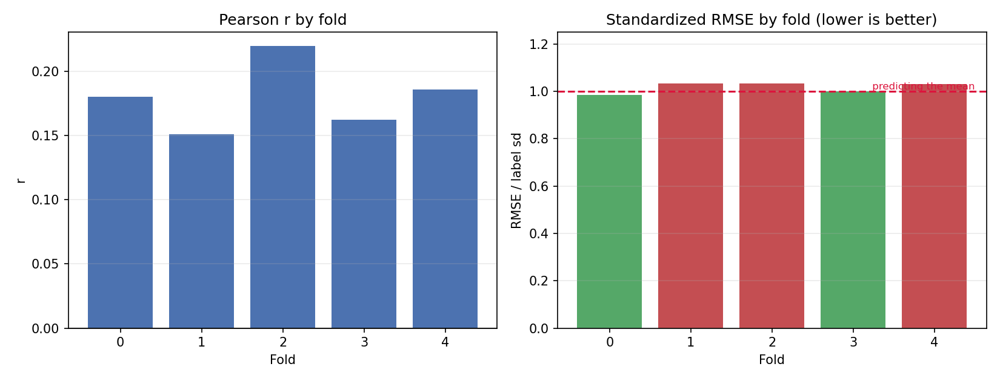
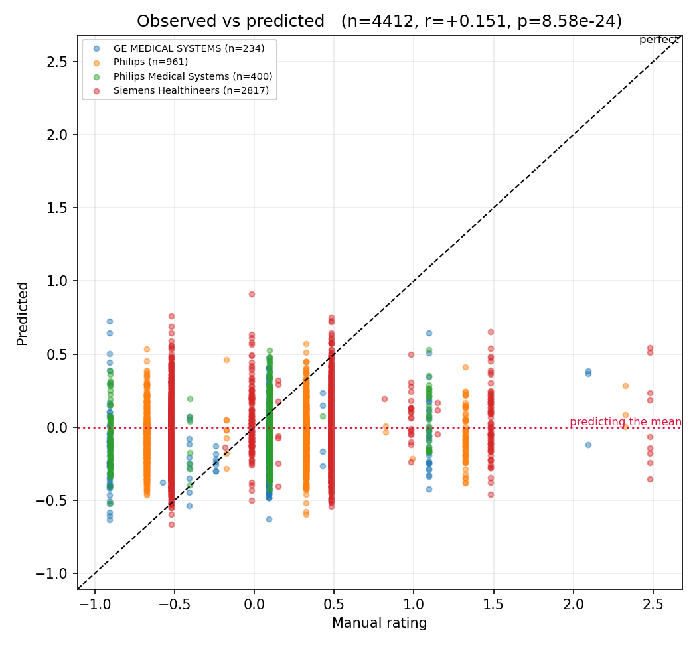
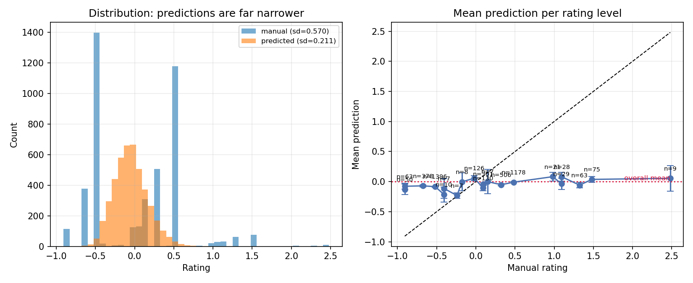
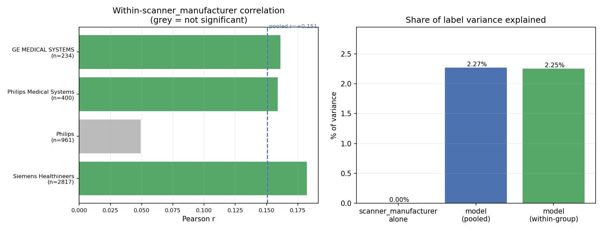
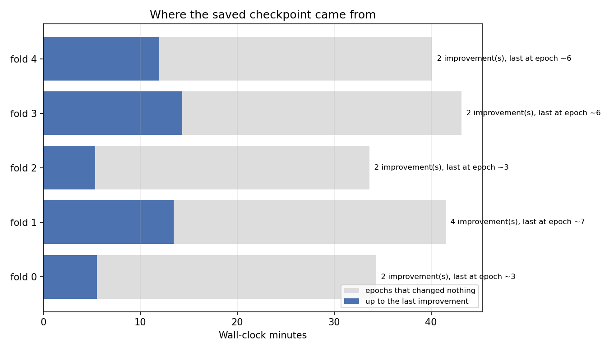

# QU_sus scanner-residualized (model_04s0r)

_Generated 2026-10-27 14:21_

## Summary

- **4412 predictions** across 5 folds, 1243 subjects
- **Pooled r = +0.151** (p = 8.58e-24), Spearman = +0.149
- **r² = 2.27%** of label variance explained
- **standardized RMSE = 1.016**
  - a mean-predictor scores exactly 1.0; this is at or above 1.0, so the model does **not** beat simply predicting the label mean
- prediction sd 0.211 vs label sd 0.570 — predictions span 37% of the label spread

## Per-fold

|   fold |   n |      r |      p |   spearman |   rmse |   label_sd |   std_rmse |
|-------:|----:|-------:|-------:|-----------:|-------:|-----------:|-----------:|
|      0 | 909 | 0.1805 | 0.0000 |     0.1701 | 0.5458 |     0.5541 |     0.9851 |
|      1 | 853 | 0.1511 | 0.0000 |     0.1685 | 0.6009 |     0.5819 |     1.0325 |
|      2 | 855 | 0.2197 | 0.0000 |     0.2230 | 0.5895 |     0.5701 |     1.0340 |
|      3 | 867 | 0.1622 | 0.0000 |     0.1437 | 0.5940 |     0.5942 |     0.9996 |
|      4 | 928 | 0.1859 | 0.0000 |     0.1882 | 0.5650 |     0.5481 |     1.0308 |

## Confound check: scanner_manufacturer

If a grouping variable shifts the label mean, a model that learns only the group offset earns a pooled correlation while carrying no within-group signal.

| group                   |    n |   label mean |   pred mean |   within r |   within p |
|:------------------------|-----:|-------------:|------------:|-----------:|-----------:|
| Siemens Healthineers    | 2817 |      -0.0004 |     -0.0409 |     0.1823 |     0.0000 |
| Philips                 |  961 |       0.0000 |     -0.0587 |     0.0492 |     0.1275 |
| Philips Medical Systems |  400 |      -0.0004 |     -0.0380 |     0.1590 |     0.0014 |
| GE MEDICAL SYSTEMS      |  234 |       0.0004 |     -0.1064 |     0.1612 |     0.0136 |

- scanner_manufacturer alone explains **0.00%** of label variance (a group-mean lookup would score r = +0.000)
- model pooled r = +0.151 (r² = 2.27%)
- sample-weighted **within-group r = +0.150** (r² = 2.25%)
- **~0% of the pooled correlation is between-group**, not within

## Convergence

|   fold |   train |   val |   epochs run |   max epochs |   improvements |   last impr. epoch |   min to last impr. |   wall min |   best val loss |
|-------:|--------:|------:|-------------:|-------------:|---------------:|-------------------:|--------------------:|-----------:|----------------:|
|      0 |    6947 |  1800 |           17 |          100 |              2 |                  3 |               5.533 |      34.33 |          0.2979 |
|      1 |    7063 |  1684 |           21 |          100 |              4 |                  7 |              13.45  |      41.52 |          0.3629 |
|      2 |    7050 |  1697 |           17 |          100 |              2 |                  3 |               5.35  |      33.65 |          0.3478 |
|      3 |    7018 |  1729 |           21 |          100 |              2 |                  6 |              14.3   |      43.12 |          0.3543 |
|      4 |    6910 |  1837 |           20 |          100 |              2 |                  6 |              11.95  |      40.1  |          0.3191 |

- total wall time 3.2 h; **2.4 h produced no improvement**
- every fold stopped early (epochs 17, 21, 17, 21, 20 of 100), so patience is doing its job
- mean best validation loss 0.3364
  - NOTE: with `--use-weighted-loss` this is a *weighted* loss and is not on the same scale as label variance (0.3244); comparing the two says nothing about accuracy. Use standardized_rmse above for that, or pass `--weight-normalize` at training time to put the loss back on the MSE scale.
## Figures

### Per-fold correlation and standardized RMSE

### Observed vs predicted

### Prediction spread and calibration

### Within-scanner_manufacturer signal vs confound

### Where the saved checkpoint came from

